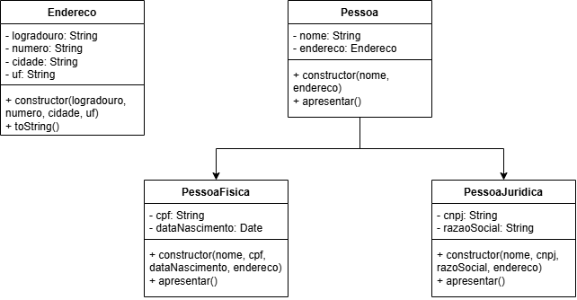
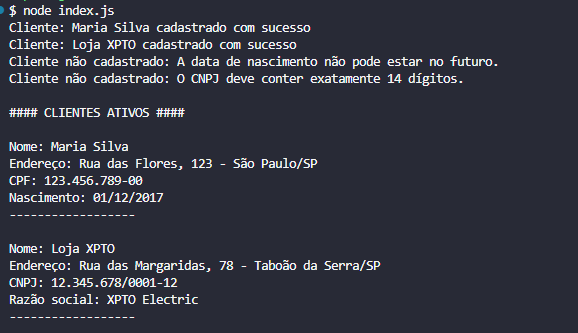

# Atividade 01 — Cadastro de Clientes da Electronic

**Estudante:** Juan Lima  
**Unidade Curricular:** Programação Orientada a Objetos / JavaScript

### Modelagem UML


### Como executar

1. Clone o repositório:
```bash
https://github.com/jlima32/atividade-electronic-desenvolvedor-mobile-flutter-senai.git
```

2. Acesse a pasta
```bash
cd atividade-electronic-desenvolvedor-mobile-flutter-senai
```

3. Execute
```bash
node index.js
```

### Evidências de teste

```javascript
//Pessoa Física Válida
cadastrarCliente("PF", 
    {
        "nome": "Maria Silva",
        "cpf": "123.456.789-00",
        "dataNascimento": "2017-12-02",
    }
    ,
    {
        "logradouro": "Rua das Flores",
        "numero": "123",
        "cidade": "São Paulo",
        "uf": "SP"
    }
)


//Pessoa Jurídica Válida
cadastrarCliente("pj", 
    {
        "nome": "Loja XPTO",
        "cnpj": "12.345.678/0001-12",
        "razaoSocial": "XPTO Electric",
    }
    ,
    {
        "logradouro": "Rua das Margaridas",
        "numero": "78",
        "cidade": "Taboão da Serra",
        "uf": "SP"
    }
)

//Pessoa Física Inválida
cadastrarCliente("PF", 
    {
        "nome": "Maria Silva",
        "cpf": "123.222.333-77",
        "dataNascimento": "2035-04-20",
    }
    ,
    {
        "logradouro": "Rua das Flores",
        "numero": "123",
        "cidade": "São Paulo",
        "uf": "SP"
    }
)


//Pessoa Jurídica Inválida
cadastrarCliente("pj", 
    {
        "nome": "Loja ABCDF",
        "cnpj": "72.743.340001-35",
        "razaoSocial": "ABCD Electric",
    }
    ,
    {
        "logradouro": "Rua da aviação",
        "numero": "22",
        "cidade": "Campinas",
        "uf": "SP"
    }
)


```

> Saída no terminal



### Histórico de commits
